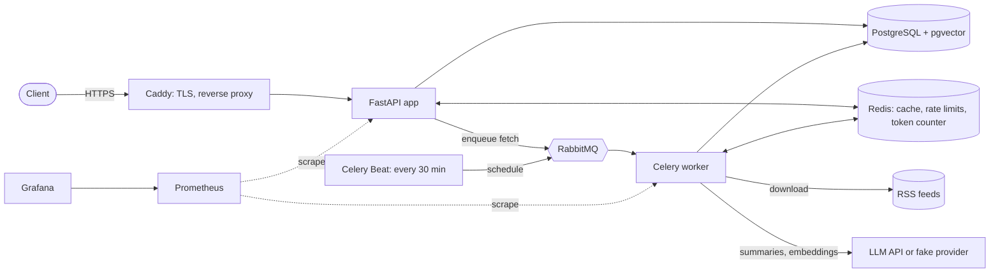
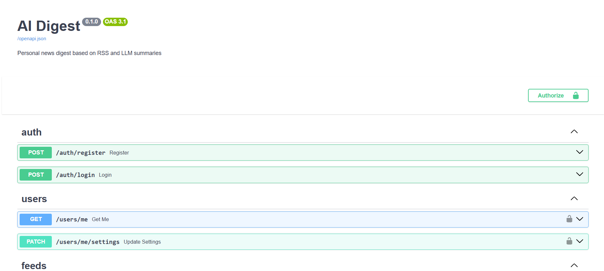
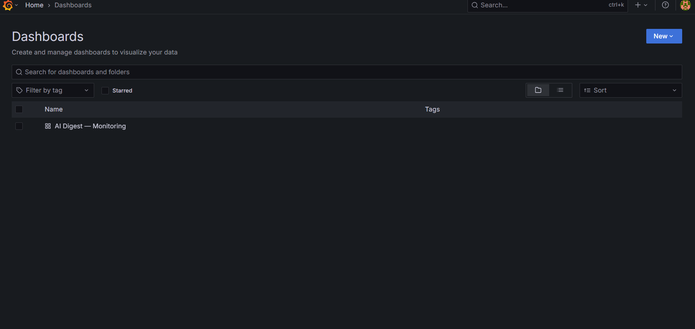

# AI Digest

[](https://github.com/adsetsuko0/ai-digest/actions/workflows/ci.yml)

Backend service for a personal news digest: users register, subscribe to RSS feeds with tags, the service collects new articles in the background, writes a short LLM summary of each one, and serves them back as a digest and through semantic search.

**Live demo:** https://ai-digest-anna.duckdns.org ([Swagger UI](https://ai-digest-anna.duckdns.org/docs)). The demo uses the fake summarizer and embedder, is meant for evaluation only (use a throwaway email and password, data can be reset at any time) and may go offline: it runs on a time-limited cloud account.

> **Status: v1.0.0.** The whole pipeline works end to end and is deployed to AWS EC2 behind HTTPS: accounts, feeds, background collection, summaries, `GET /digest`, `GET /search`, Prometheus metrics, and a CI/CD pipeline that ships a container image. A fake summarizer and a fake embedder let you try everything without an API key. See the limitations and the roadmap at the end.

## Tech stack

**Python 3.12 - FastAPI - Pydantic v2 - SQLAlchemy 2 (async API, sync worker) - Alembic - PostgreSQL 16 with pgvector - Redis - Celery + RabbitMQ - httpx - feedparser - structlog - Prometheus - Grafana - Docker Compose - Caddy - AWS EC2 - GitHub Actions and GitHub Container Registry - pytest - respx - ruff - pre-commit**

## Architecture



A user adds a feed: the API stores it and queues a download. Beat also queues every active feed every 30 minutes. The worker downloads and parses the feed, stores new articles, queues a summary task for each one and an embedding task after it. The client reads the results through `/digest` and `/search`. Locally, Prometheus and Grafana run in the optional `monitoring` profile. In production, they run as a separate Compose project.

## What works today

- **Auth:** registration and login with JWT access tokens. The token carries the user id, passwords are hashed with bcrypt, and login runs a dummy hash for unknown emails so response time does not reveal which accounts exist.
- **Rate limits** per client IP, stored in Redis: 10 registrations per hour, 10 logins per minute, 60 digest requests per minute, 30 searches per minute.
- **Feeds:** add, list (limit/offset pagination) and delete RSS feeds with tags. Feed URLs are validated to block private and internal addresses. Duplicate subscriptions are rejected by a database constraint. A new feed is fetched right away; if the broker is down, adding the feed still succeeds.
- **Article collection:** Celery Beat runs every 30 minutes. Each active feed that has at least one subscriber gets its own task with a random start delay of up to 60 seconds. A task downloads the feed safely, parses RSS and Atom, removes duplicates (by normalized URL and by content hash) and stores new articles. Repeating a task never creates duplicates.
- **Safe feed fetcher:** the host is resolved and every address is checked on each download, redirects are followed manually and re-checked, the response is streamed with a 2 MB limit (which also stops compression bombs), and conditional requests (`ETag`, `Last-Modified`) save traffic.
- **Error handling:** temporary errors (5xx, 429, timeouts, DNS failures) are retried with growing delays. Permanent errors are counted, the reason is saved in `last_error`, and a feed that fails 5 times in a row is disabled automatically.
- **Summaries:** every new article gets a 2-3 sentence summary from any OpenAI-compatible API. With `LLM_PROVIDER=fake` a deterministic fake summarizer (the first two sentences) is used, so the demo needs no key.
- **Spend control:** a daily token budget kept in Redis, a cache of summaries by content hash (the same text is never paid for twice), limits on input and output size, and retries only for temporary errors.
- **Digest:** `GET /digest` returns summaries of articles from your own feeds, newest first, with filters by tag, feed and date, keyset pagination and a 60 second Redis cache.
- **Semantic search:** each summarized article gets an embedding stored with pgvector. `GET /search` ranks your own articles by cosine similarity to the query. A fake, word-based embedder works without a key.
- **Observability:** Prometheus metrics for the API (requests, latency) and the worker (articles fetched, fetch errors, summaries by status, LLM tokens, summary latency) served on port 9100 inside the Compose network, a Grafana dashboard, and structured logs for every task (`feed_id`, `article_id`, `status`, `tokens`, `duration_ms`).
- **Data isolation:** users see only their own feeds, digest and search results (covered by tests, including a test on real PostgreSQL).
- **User settings:** digest time and timezone (stored for the future delivery of the digest).
- **Health checks:** `/health` and `/health/ready` (checks the database).
- **Production deployment:** a Docker Compose stack on AWS EC2 behind Caddy with automatic HTTPS, shipped as a container image from GitHub Container Registry, with restart policies (the stack comes back by itself after a reboot).
- **CI/CD:** GitHub Actions runs ruff and the test suite with an 80% coverage gate, a type check with mypy, integration tests against a real PostgreSQL with pgvector, and a container build check. A weekly `pip-audit` run and Dependabot watch the dependencies. Pushing a tag `vX.Y.Z` builds and publishes the image.
- **Quality:** 350+ tests (4 of them need a real PostgreSQL with pgvector), ruff and pre-commit, containers run as a non-root user.

## Screenshots





## Quick start (Docker)

```bash
cp .env.example .env                  # then fill in SECRET_KEY, POSTGRES_PASSWORD and RABBITMQ_PASSWORD
docker compose up -d --build
docker compose exec app alembic upgrade head
```

Open http://127.0.0.1:8000/docs for the interactive API docs.

Generate a value for each secret with:

```bash
python -c "import secrets; print(secrets.token_urlsafe(48))"
```

`docker-compose.override.yml` is applied automatically: it mounts the source code, runs the server with `--reload` and publishes PostgreSQL on `127.0.0.1:5433`. The production stack is `docker-compose.prod.yml`, see Deployment.

Set GRAFANA_PASSWORD in .env first.

### With monitoring

```bash
docker compose --profile monitoring up -d --build
```

| What | Local address |
|---|---|
| API and Swagger | http://127.0.0.1:8000/docs |
| API metrics | http://127.0.0.1:8000/metrics |
| Prometheus | http://127.0.0.1:9090 (targets: `/targets`) |
| Grafana | http://127.0.0.1:3000 |
| RabbitMQ management | http://127.0.0.1:15673 (user and password from `.env`) |

All of them are bound to `127.0.0.1` only.

### Try it

Register, add a feed and wait about half a minute for the first summaries. Use `BASE=https://ai-digest-anna.duckdns.org` instead to try the live demo.

```bash
BASE=http://127.0.0.1:8000

curl -s -X POST $BASE/auth/register \
  -H "Content-Type: application/json" \
  -d '{"email":"me@example.com","password":"correct-horse-1"}'

TOKEN=$(curl -s -X POST $BASE/auth/login \
  -H "Content-Type: application/json" \
  -d '{"email":"me@example.com","password":"correct-horse-1"}' \
  | python -c "import sys, json; print(json.load(sys.stdin)['access_token'])")

curl -s -X POST $BASE/feeds \
  -H "Authorization: Bearer $TOKEN" -H "Content-Type: application/json" \
  -d '{"url":"https://feeds.bbci.co.uk/news/technology/rss.xml","tags":["tech"]}'

curl -s "$BASE/digest?tag=tech&limit=5" -H "Authorization: Bearer $TOKEN"
curl -s "$BASE/search?q=python&limit=5" -H "Authorization: Bearer $TOKEN"
```

A page of the digest looks like this; pass `next_cursor` as `?cursor=` to get the next page:

```json
{
  "items": [
    {
      "id": 42,
      "title": "Article title",
      "url": "https://example.com/article",
      "summary": "Two or three sentences.",
      "feed": {"id": 1, "title": "Feed title"},
      "published_at": "2026-11-20T09:30:00Z",
      "tags": ["tech"]
    }
  ],
  "next_cursor": "WyIyMDI2LTExLTIwVDA5OjMwOjAwKzAwOjAwIiwgNDJd"
}
```

### Collecting articles by hand

Beat starts collection every 30 minutes on its own. To run it by hand:

```bash
docker compose exec worker celery -A app.worker.celery_app:celery_app call app.worker.tasks.fetch_all_feeds
docker compose logs -f worker
```

Tasks start with a random delay of up to 60 seconds. Check the state of your articles with:

```bash
docker compose exec db psql -U digest_user -d digest_db \
  -c "select summary_status, count(*), sum(tokens_used), count(embedding) from articles group by 1"
```

## Configuration

| Variable | Required | Description |
|---|---|---|
| `SECRET_KEY` | yes | JWT signing key, at least 32 characters |
| `POSTGRES_PASSWORD` | yes (Docker) | Password of the database user |
| `RABBITMQ_PASSWORD` | yes (Docker) | Password of the RabbitMQ user |
| `GRAFANA_PASSWORD` | with monitoring | Grafana admin password; the `monitoring` profile refuses to start without it |
| `DOMAIN` | production | Public host name served by Caddy |
| `POSTGRES_USER` | no | Database user, default `digest_user` |
| `POSTGRES_DB` | no | Database name, default `digest_db` |
| `RABBITMQ_USER` | no | RabbitMQ user, default `digest` |
| `ACCESS_TOKEN_EXPIRE_MINUTES` | no | Token lifetime, default `30` |
| `RATE_LIMIT_ENABLED` | no | Set to `false` to turn rate limits off, default `true` |
| `FETCH_INTERVAL_SECONDS` | no | How often Beat starts collection, default `1800` (minimum `60`) |
| `FEED_MAX_CONSECUTIVE_ERRORS` | no | Permanent errors in a row before a feed is disabled, default `5` |
| `LOG_JSON` | no | `true` for JSON logs, default `false` (Docker Compose sets `true`) |
| `LLM_PROVIDER` | no | `fake` (default, no key needed) or `openai` (any OpenAI-compatible API) |
| `LLM_BASE_URL` | with `openai` | API address without `/chat/completions`, e.g. `https://api.openai.com/v1` |
| `LLM_API_KEY` | with `openai` | API key, never logged and never put into error messages |
| `LLM_MODEL` | with `openai` | Model used for summaries |
| `LLM_DAILY_TOKEN_BUDGET` | no | Tokens per UTC day, default `200000`; at the limit new articles are skipped, `0` blocks everything |
| `EMBEDDING_PROVIDER` | no | `fake` (default) or `openai` (uses the same `LLM_BASE_URL` and `LLM_API_KEY`) |
| `EMBEDDING_MODEL` | with `openai` | Embedding model |
| `EMBEDDING_DIM` | no | Vector size, default `384`; must match the model, see the limitations |


Database, Redis and RabbitMQ URLs are assembled in the Compose files from these values. The API uses `DATABASE_URL` (asyncpg), the worker uses `DATABASE_SYNC_URL` (psycopg2). `deploy/env.prod.example` lists what to set on the server (domain, image version, passwords).

## API overview

| Method | Path | Auth | Description |
|---|---|---|---|
| POST | `/auth/register` | no | Create an account |
| POST | `/auth/login` | no | Get an access token |
| GET | `/users/me` | yes | Current user |
| PATCH | `/users/me/settings` | yes | Digest time and timezone |
| POST | `/feeds` | yes | Add a feed with tags |
| GET | `/feeds?limit=&offset=` | yes | List your feeds |
| DELETE | `/feeds/{id}` | yes | Remove a feed |
| GET | `/digest?tag=&feed_id=&since=&limit=&cursor=` | yes | Summaries from your feeds, newest first |
| GET | `/search?q=&limit=` | yes | Your articles closest to the query |
| GET | `/health`, `/health/ready` | no | Liveness and readiness |
| GET | `/metrics` | no | Prometheus metrics; scraped internally by local and production monitoring, but not exposed publicly |

## Observability

- **API metrics:** request counts and latency per route at `/metrics`.
- **Worker metrics:** `articles_fetched_total`, `fetch_errors_total` (by kind), `summaries_total` (by status), `llm_tokens_total` and `summary_latency_seconds`. A Celery worker runs several processes, so the worker uses Prometheus' multiprocess mode, otherwise counters incremented in child processes would be invisible. Threads instead of processes would not help: task time limits only work with the process pool.
- **Local monitoring:** Prometheus and Grafana are in the optional `monitoring` Compose profile. Prometheus scrapes the API and worker every 15 seconds; the Grafana dashboard and data source are provisioned from `deploy/grafana`.
- **Production monitoring:** Prometheus and Grafana run in a separate Compose project defined by `docker-compose.monitoring.yml`. They scrape the API and worker over the Docker network. Grafana is accessed through an SSH tunnel.
- **Logs:** structured logs with the outcome of every task, JSON under Docker Compose.
- **Access:** `/metrics` is not reachable from the public internet. Production Grafana is bound to the server's loopback interface and accessed through an SSH tunnel.

## Deployment

The demo runs as a Docker Compose stack on one small AWS EC2 instance (Ubuntu 24.04, `t3.small`, `eu-north-1`) with swap. The application stack has seven containers: API, worker, Beat, PostgreSQL, Redis, RabbitMQ and Caddy. Prometheus and Grafana run separately in another Compose project.

**How a release reaches the server**

1. Pushing a tag `vX.Y.Z` runs the Release workflow. It builds the image and publishes it to GitHub Container Registry (`ghcr.io/adsetsuko0/ai-digest`).
2. On the server, `bash deploy/deploy.sh X.Y.Z` pulls exactly that image, applies the database migrations, restarts the stack and checks `/health`. The version is remembered, so a later plain `docker compose up` does not go back to an older image.
3. Rolling back means deploying the previous tag (safe when the newer version added no migrations).

The server never builds code, it only runs an image that was already tested in CI. The deploy is manual on purpose: SSH is open only from the owner's address, so a CI runner cannot reach the server.

**What is exposed**

- Only ports 80 and 443 (Caddy, with a certificate that is issued and renewed automatically) and SSH from the owner's address.
- PostgreSQL, Redis and the RabbitMQ broker port are not published. The RabbitMQ management UI is bound to the server's loopback address only and is reached through an SSH tunnel. Docker bypasses host firewalls such as `ufw` for published ports, so not publishing a port is the real protection.
- The application port is not published either, so only Caddy can reach the app. That is why trusting the forwarded headers (`FORWARDED_ALLOW_IPS=*`) is safe here, and rate limits see real client addresses instead of the proxy's.
- `/metrics` answers 404 on the public address.

**Secrets and configuration:** the `.env` file lives only on the server (mode 600) and never in the repository or in the image. The Compose file is selected with `COMPOSE_FILE=docker-compose.prod.yml` in that `.env`, so a plain `docker compose` command on the server never picks up the development stack.

**Cost control:** the demo runs on an account with a spending cap and a limited number of credits, the LLM and embedding providers are fake, real providers have a daily token budget, and the instance is stopped when it is not needed. The cloud plan ends on 21 May 2027 and the demo goes offline with it.

## Running the tests

```bash
python -m venv .venv
source .venv/bin/activate             # Windows: .venv\Scripts\activate
pip install -r requirements-dev.txt
pytest --cov=app
```

The main suite uses an in-memory SQLite database, so neither Docker nor Postgres is needed. Network access is faked with `respx`, and DNS lookups are replaced in the tests, so nothing goes to the internet.

Four integration tests check vector search and pagination on a real PostgreSQL with pgvector. They are skipped by default (CI runs them against a PostgreSQL service). Point `TEST_DATABASE_URL` at an empty database whose name ends with `_test` (the tables are dropped), for example with the Compose database:

```bash
docker compose exec db psql -U digest_user -d postgres -c "CREATE DATABASE digest_test"
TEST_DATABASE_URL=postgresql+asyncpg://digest_user:<password>@127.0.0.1:5433/digest_test pytest -m integration
```

## Project structure

```
app/
  api/        route handlers (auth, users, feeds, digest, search)
  core/       settings, JWT and bcrypt, rate limiting, Redis clients, URL validation, logging, metrics
  db/         async engine for the API, sync session for the worker
  models/     SQLAlchemy models
  schemas/    Pydantic request and response models
  services/   feed fetcher and parser, article storage, summarizer, embedder,
              token budget, digest and search queries
  worker/     Celery app and tasks
migrations/   Alembic migrations
tests/        pytest suite (tests/integration needs PostgreSQL)
deploy/       Caddyfile, deploy.sh, env.prod.example, Prometheus and Grafana configuration
docs/         screenshots
docker-compose.yml           development stack (plus the monitoring profile)
docker-compose.override.yml  development overrides, applied automatically
docker-compose.prod.yml      production application stack
docker-compose.monitoring.yml production monitoring stack
.github/workflows/  CI, release and weekly dependency audit pipelines (plus Dependabot)
```

## Design decisions

- **JWT stores the user id, not the email**, so changing an email does not invalidate the identity in a token.
- **Uniqueness is enforced by the database** (unique constraints), because a "check then insert" in code can be beaten by two simultaneous requests.
- **Two-stage SSRF protection.** The URL format is checked when a feed is added. The host is resolved and every address is checked again on every download, because DNS records can change after the feed was added. Redirects are followed manually so that each target goes through the same checks, and the response is read as a stream with a size limit.
- **Sync worker, async API.** Celery workers are synchronous, so they use a sync SQLAlchemy engine created lazily on first use. The API stays fully asynchronous. This is why there are two database URLs.
- **Idempotent tasks.** With `acks_late` a task can run twice, for example when a worker dies in the middle of it. Storing articles never creates duplicates (unique URLs, a content hash for the same text under another URL, savepoints when two workers race). A summary task works only on articles that are still `pending`, so a repeated delivery does nothing.
- **Temporary and permanent errors are treated differently.** Retrying a 503 makes sense, retrying a 404 does not. Permanent errors increase a counter and disable the feed after several in a row.
- **Nothing holds a database connection during a network call.** A task reads what it needs, closes the transaction, calls the feed or the LLM, and only then opens a new transaction to save the result. Tasks are enqueued only after the commit, so a worker can always find its article.
- **Prompt injection is handled in layers.** An article is untrusted text. The system prompt says so and forbids following instructions inside it. The text goes between `<article>` tags with all angle brackets escaped (so it cannot close the tag), control characters are removed and the input is cut to 6000 characters. The model's answer is treated as untrusted too: tags and control characters are stripped, it is collapsed to one paragraph, checked for emptiness and cut to 1000 characters. The model has no tools, so the worst a successful injection can do is produce a wrong summary. The API key never appears in logs or errors (only the HTTP status is kept), and redirects are not followed, so the key cannot be sent to another host.
- **Spend control has several lines of defense.** A summary of an already summarized text is copied by content hash and costs 0 tokens. A daily budget is kept in a Redis counter (`llm:tokens:<UTC date>`, expires after two days); at the limit articles are marked `skipped`. If Redis is down, the task is retried instead of working without a budget. If only the accounting fails after the money was spent, the summary is kept.
- **Keyset pagination instead of offset.** The digest is ordered by `coalesce(published_at, fetched_at)` and `id`, and the cursor holds the position of the last item. New articles that arrive between two requests do not shift the next page or repeat items, and the database never counts past skipped rows. Many feeds give no date, which is why the collection time is the fallback.
- **Redis has a narrow role:** it caches digest pages (60 seconds, the user id is part of the key), stores rate limit counters and the daily token counter. It is not a queue: RabbitMQ is the broker.
- **The cache and Redis are optional for correctness.** If Redis is down, `/digest` reads from the database.
- **The pgvector Postgres image is used from the start**, so semantic search did not require changing the database image later.
- **An image is shipped, nothing is built on the server.** One image is built and tested once in CI, the server only pulls it. A rollout is `pull`, migrate, `up`, and a rollback is deploying the previous tag.
- **Only the reverse proxy faces the internet.** Every other service lives inside the Docker network, and the proxy hides `/metrics`.
- **Monitoring is separated from the application stack.** Local monitoring is an optional Compose profile. On the production server, Prometheus and Grafana run in a separate Compose project, keeping them independent from application deployments.

## Known limitations

- **DNS rebinding.** The host name is resolved once for the safety check and once more when the connection is made. A DNS server that changes its answer in between could slip a private address past the check. The full fix is to connect directly to the verified IP address. Until then, an egress firewall that blocks private ranges for the worker closes the gap.
- **`skipped` and `failed` are final statuses.** An article skipped because the daily budget ran out is not summarized again the next day, and an article whose summary failed permanently is not retried.
- **Fake embeddings are not semantic.** The fake embedder compares words, so "car" and "automobile" are unrelated for it. Real meaning needs `EMBEDDING_PROVIDER=openai`.
- **Changing `EMBEDDING_DIM` needs a migration** (the column size is fixed when the migration runs) and re-embedding of all articles.
- **Rate limits are counted per client IP.** The address comes from the forwarded headers set by Caddy. Behind a proxy that does not set them, all users would share one address.
- **Search has no vector index yet**, so it compares the query with every article of the user (exact, fine at this size). With an approximate index the filter by user would be applied after the index lookup, so a user with few articles could get fewer results than `limit`. A larger deployment needs another approach, for example partitioning or filtered search.
- **The digest can be up to 60 seconds behind** because of the cache.
- **A feed disabled automatically stays disabled.** There is no endpoint to re-enable it yet.
- **The digest is only pulled.** Delivery (Telegram, email) and sending at `digest_time` are not implemented, the setting is stored for later.
- **One machine, no failover.** The database lives in a Docker volume on a single server, and there are no automated backups (the demo holds no real data).
- **Manual deploy.** The image is built automatically, but the rollout is a command run over SSH from the owner's address.
- **No monitoring alerts.** Prometheus and Grafana run on the server, but there are no alerting rules or notification channels yet.
- **The demo is temporary.** It runs on a time-limited cloud account and goes offline on 21 May 2027.

## Roadmap

- An endpoint to re-enable a disabled feed.
- Delivery of the digest at the user's `digest_time`.
- Automated backups of the database.
- Automated deploy without opening SSH (for example AWS SSM with GitHub OIDC).
- Monitoring alerts and notification channels.

Out of scope for now: a web interface, several LLM providers, OPML import, OAuth, email confirmation and password reset, refresh tokens.

## License

MIT, see [LICENSE](LICENSE).